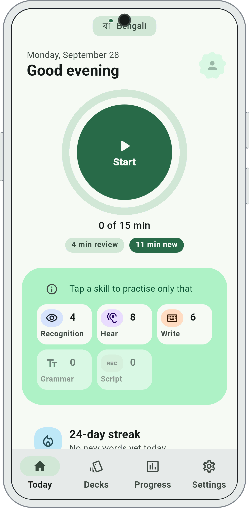
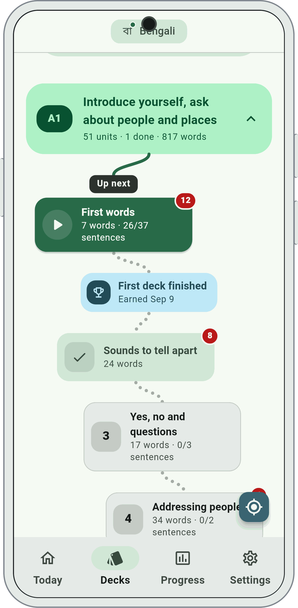
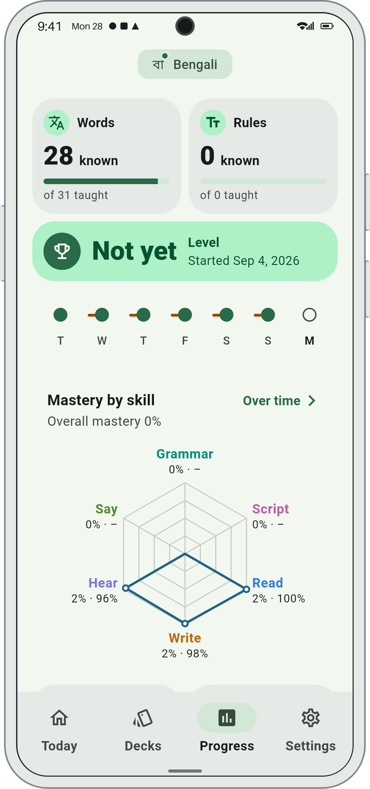
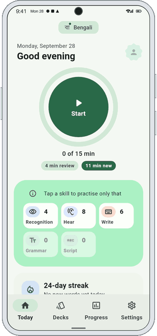
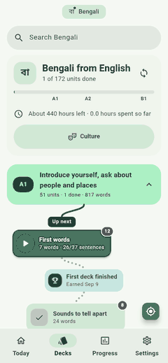
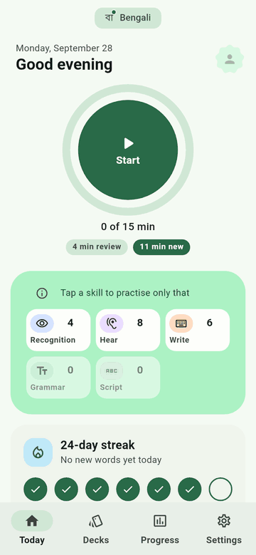
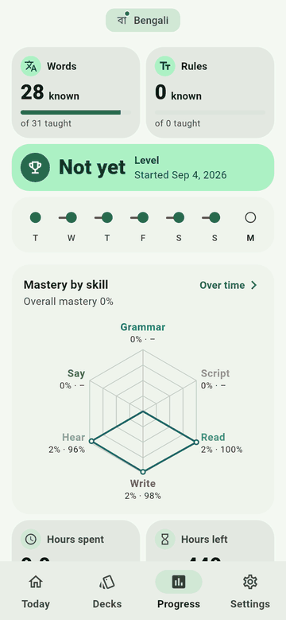
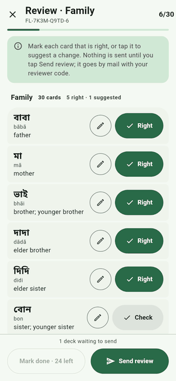

<picture>
  <source media="(prefers-color-scheme: dark)" srcset="fluenough-brand/fluenough-lockup-dark.svg">
  
</picture>

 

*Fluent enough.*

A language-agnostic drilling app for basic language skills — vocabulary,
production, listening and grammar — scheduled by spaced repetition, running
offline on your phone once a language's decks are downloaded.

  
  
  
  
  
  
  
  
  

  <a href="https://github.com/aaronified/fluenough/releases/latest"><b>Download</b></a> ·
  <a href="https://github.com/aaronified/fluenough/wiki/Courses-and-Paths">Courses</a> ·
  <a href="https://github.com/aaronified/fluenough/wiki/Deck-Building-Guide">Decks</a> ·
  <a href="https://github.com/aaronified/fluenough/wiki/Contributing">Contribute</a> ·
  <a href="https://github.com/aaronified/fluenough/wiki/Roadmap">Roadmap</a>

> **Status: in active development (v0.11.3).** The app runs on Android phones,
> with the drills, spaced repetition, placement, stats, culture and private
> decks built, and progress is saved on the phone. Many courses are still
> being written, and a feature not built yet is shown disabled, marked "Feature
> incoming". See
> [wiki Roadmap](https://github.com/aaronified/fluenough/wiki/Roadmap).

## Screenshots

A Bengali learner from English, three and a half weeks in.

<table align="center">
  <tr>
    <td align="center"><strong>Home</strong></td>
    <td align="center"><strong>Decks</strong></td>
    <td align="center"><strong>Progress</strong></td>
  </tr>
  <tr>
    <td align="center"></td>
    <td align="center"></td>
    <td align="center"></td>
  </tr>
</table>

A learning session: a new word is shown, then asked in different ways, and
it counts as learned only when both answers are right.

More: scrolling through the screens, and reviewing

<table align="center">
  <tr>
    <td align="center"><strong>Deck path</strong></td>
    <td align="center"><strong>Today</strong></td>
  </tr>
  <tr>
    <td align="center"></td>
    <td align="center"></td>
  </tr>
  <tr>
    <td align="center"><strong>Progress</strong></td>
    <td align="center"><strong>Reviewing</strong></td>
  </tr>
  <tr>
    <td align="center"></td>
    <td align="center"></td>
  </tr>
</table>

## Features

- **FSRS scheduling.** Every word is scheduled with FSRS-6, aiming at 90%
  recall, in place of the older SM-2. The app fits FSRS's parameters to your
  own answers, separately for each language and skill, so words you find easy
  come back less often. Every answer goes to an append-only review log, and
  everything else is worked out from it.
  ([ADR-0033](https://github.com/aaronified/fluenough/wiki/ADR-0033-Fsrs),
  [ADR-0035](https://github.com/aaronified/fluenough/wiki/ADR-0035-Fsrs-Fitted-Per-Skill))
- **Indian languages first.** Courses for Telugu, Bengali, Marathi, Kannada,
  Assamese, Hindustani and Gujarati, each starting with script decks (digits
  included) and a script guide. Every word has a Latin-letter reading, based
  on ISO 15919, and you can switch it off to see only the script.
  ([Scripts and readings](https://github.com/aaronified/fluenough/wiki/Scripts-and-Readings))
- **Detailed stats on your learning habits.** The Progress tab shows the words,
  rules and sentences you know against what you have been taught; your level
  (A1, A2 or B1) from the path's milestones; a 7-day calendar with your
  streak; a six-point mastery star (grammar, script, read, write, hear, say);
  the hours you have spent and the hours left to the end of B1; your weakest
  topics; and the cards you keep missing.
  ([Progress and stats](https://github.com/aaronified/fluenough/wiki/Progress-and-Stats))
- **Several scripts.** Hindustani is one course in Devanagari or Perso-Arabic
  (Urdu), and Chinese in simplified or traditional characters; you choose, or
  learn both. Punjabi is set up for Gurmukhi or Shahmukhi, with a phrasebook and a
  first-words deck so far. Each Indic course teaches its script first, or lets you learn in Latin
  letters and come back to the script later. Toki Pona can be read in Latin
  letters, in sitelen pona or both. Text in Latin, Cyrillic and Greek is drawn
  in one downloaded font per script, and for the other scripts the app shows a
  sample line, asks whether you can read it, and fetches the script's font
  only if it shows boxes.
- **Culture and recommendations.** The Culture button on the Decks screen
  switches the course path to a list of culture decks, then the books, films,
  songs and other works the course recommends. Each language has its own
  Culture options, and everything is open whatever your level.
- **A word is learned when you answer it twice.** A new word is shown, asked
  at once, and asked again in a different way two questions later; only when
  both answers are right does it join your reviews.
- **Your own decks.** Settings, Your decks adds a private language, or your
  own version of a course, from a `.fnzip` file; it is checked before it is
  added, and nothing you add leaves your phone.
- **Speaking, including on the device.** Say listens through your phone's
  recogniser. For Telugu, an on-device listener can be installed from the
  Voices page, so it works offline.
- **Hear, Say, Read, Write.** The app's own skill model: each word has a
  separate schedule for each of the four, because you can recognise a word
  long before you can write it, and grammar is scheduled on its own. It is
  how Fluenough organises practice, not an exam or an official standard.
  ([Drills and skills](https://github.com/aaronified/fluenough/wiki/Drills-and-Skills))
- **Community reviews.** Many decks were written without a native speaker. In
  reviewer mode, a reader who knows both languages marks cards right or wrong,
  proposes a fix and says how rude a word sounds; a review bot turns the
  reviews into proposed changes to the decks, which reach learners once enough
  other reviewers accept them.
  ([Reviewing guide](https://github.com/aaronified/fluenough/wiki/Reviewing-Guide),
  [ADR-0038](https://github.com/aaronified/fluenough/wiki/ADR-0038-Review-Proposals))
- **Report a mistake.** The bug icon on a card, deck, unit, topic or culture
  item opens a short list of what is wrong with that one thing; a general
  problem report is in the Settings menu.
  ([Reporting a problem](https://github.com/aaronified/fluenough/wiki/Reporting-a-Problem))
- **Add a language.** The picker shows eight big tiles (Spanish, French,
  Telugu, Hindustani, Bengali, Marathi, Kannada and Japanese) with how far each
  course is written, keeps the full list one tap away, and folds languages with
  no course yet under Coming soon.

## Why Fluenough is different

Most drilling apps are built around one language and then stretched to fit
others. Fluenough inverts that: **a language is just data.** A deck is a text
file, the card model is a superset that accommodates Latin, syllabic and
logographic scripts alike, and grammar is described by pattern tables rather
than hard-coded rules. Adding a language means adding files, never code.

## Courses

Taught from English. Every course has a B1 plan in its path: the units up to
B1, in teaching order, those not yet written shown as "Coming". The list
below is written from `decks/index.json` each time the decks change.

<!-- languages:start -->
**91 languages**

| Language | Family | Subfamily | Scripts | Level reached |
|---|---|---|---|---|
| Afrikaans | Indo-European | Germanic | Latin | in progress |
| American Sign Language | Sign language | French Sign Language | SignWriting | in progress |
| Arabic | Afro-Asiatic | Semitic | Arabic | in progress |
| Aramaic (Imperial) | Afro-Asiatic | Semitic | Hebrew | in progress |
| Archaic Greek | Indo-European | Hellenic | Greek | in progress |
| Ashokan Prakrit | Indo-European | Indo-Aryan | Devanagari, Brahmi | in progress |
| Assamese | Indo-European | Indo-Aryan | Eastern Nagari | B1 |
| Awadhi | Indo-European | Indo-Aryan | Devanagari | in progress |
| Basque | Isolate | — | Latin | in progress |
| Bengali | Indo-European | Indo-Aryan | Eastern Nagari | B1 |
| Bhojpuri | Indo-European | Indo-Aryan | Devanagari | in progress |
| Bodo | Sino-Tibetan | Tibeto-Burman | Devanagari | in progress |
| Cantonese | Sino-Tibetan | Sinitic | Traditional Hanzi | in progress |
| Catalan | Indo-European | Romance | Latin | in progress |
| Chhattisgarhi | Indo-European | Indo-Aryan | Devanagari | in progress |
| Classical Greek | Indo-European | Hellenic | Greek | in progress |
| Classical Sanskrit | Indo-European | Indo-Aryan | Devanagari | B1 |
| Dogri | Indo-European | Indo-Aryan | Devanagari | in progress |
| Dutch | Indo-European | Germanic | Latin | in progress |
| Egyptian | Afro-Asiatic | Egyptian | Egyptian hieroglyphs | in progress |
| Esperanto | Constructed | Romance | Latin | in progress |
| Filipino | Austronesian | Malayo-Polynesian | Latin | in progress |
| Finnish | Uralic | Finnic | Latin | in progress |
| French | Indo-European | Romance | Latin | B1 |
| Garhwali | Indo-European | Indo-Aryan | Devanagari | in progress |
| German | Indo-European | Germanic | Latin | A1 |
| Goan Konkani | Indo-European | Indo-Aryan | Latin | in progress |
| Greek (Modern) | Indo-European | Hellenic | Greek | A1 |
| Gujarati | Indo-European | Indo-Aryan | Gujarati | B1 |
| Haryanvi | Indo-European | Indo-Aryan | Devanagari | in progress |
| Hausa | Afro-Asiatic | Chadic | Latin | in progress |
| Hebrew | Afro-Asiatic | Semitic | Hebrew | in progress |
| Hindustani | Indo-European | Indo-Aryan | Devanagari, Perso-Arabic | B1 |
| Hungarian | Uralic | Ugric | Latin | in progress |
| Indian Sign Language | Sign language | — | SignWriting | in progress |
| Indonesian | Austronesian | Malayo-Polynesian | Latin | in progress |
| Interslavic | Constructed | Slavic | Latin, Cyrillic | in progress |
| Irish | Indo-European | Celtic | Latin | in progress |
| Italian | Indo-European | Romance | Latin | A1 |
| Japanese | Japonic | — | Kana, Kanji | B1 |
| Kannada | Dravidian | South | Kannada | B1 |
| Kashmiri | Indo-European | Indo-Aryan | Perso-Arabic, Devanagari | in progress |
| Khasi | Austroasiatic | Khasian | Latin | in progress |
| Koine Greek | Indo-European | Hellenic | Greek | in progress |
| Konkani | Indo-European | Indo-Aryan | Devanagari, Kannada, Malayalam | in progress |
| Korean | Koreanic | — | Hangul | A1 |
| Kumaoni | Indo-European | Indo-Aryan | Devanagari | in progress |
| Latin | Indo-European | Italic | Latin | in progress |
| Lojban | Constructed | None | Latin | in progress |
| Magahi | Indo-European | Indo-Aryan | Devanagari | in progress |
| Maithili | Indo-European | Indo-Aryan | Devanagari | in progress |
| Malay | Austronesian | Malayo-Polynesian | Latin | in progress |
| Malayalam | Dravidian | South | Malayalam | A1 |
| Mandarin Chinese | Sino-Tibetan | Sinitic | Simplified Hanzi, Traditional Hanzi | B1 |
| Manipuri | Sino-Tibetan | Tibeto-Burman | Eastern Nagari, Meitei Mayek | in progress |
| Marathi | Indo-European | Indo-Aryan | Devanagari | B1 |
| Middle English | Indo-European | Germanic | Latin | in progress |
| Mizo | Sino-Tibetan | Tibeto-Burman | Latin | in progress |
| Mycenaean Greek | Indo-European | Hellenic | Linear B | in progress |
| Nepali | Indo-European | Indo-Aryan | Devanagari | in progress |
| Norwegian (Bokmål) | Indo-European | Germanic | Latin | in progress |
| Odia | Indo-European | Indo-Aryan | Odia | in progress |
| Old English | Indo-European | Germanic | Latin | in progress |
| Pali | Indo-European | Indo-Aryan | Devanagari | in progress |
| Pashto | Indo-European | Iranian | Perso-Arabic | in progress |
| Persian | Indo-European | Iranian | Perso-Arabic | in progress |
| Polish | Indo-European | Slavic | Latin | A1 |
| Portuguese | Indo-European | Romance | Latin | in progress |
| Proto-Indo-European | Indo-European | — | Latin | in progress |
| Punjabi | Indo-European | Indo-Aryan | Gurmukhi, Shahmukhi | in progress |
| Quechua | Quechuan | — | Latin | in progress |
| Rajasthani | Indo-European | Indo-Aryan | Devanagari | in progress |
| Russian | Indo-European | Slavic | Cyrillic | A1 |
| Santali | Austroasiatic | Munda | Ol Chiki, Latin, Devanagari, Eastern Nagari | in progress |
| Serbo-Croatian | Indo-European | Slavic | Latin, Cyrillic | in progress |
| Sindhi | Indo-European | Indo-Aryan | Perso-Arabic, Devanagari | in progress |
| Somali | Afro-Asiatic | Cushitic | Latin | in progress |
| Spanish | Indo-European | Romance | Latin | B1 |
| Sumerian | Isolate | — | Cuneiform | in progress |
| Swahili | Niger-Congo | Bantu | Latin | A1 |
| Swedish | Indo-European | Germanic | Latin | in progress |
| Tamil | Dravidian | South | Tamil | B1 |
| Telugu | Dravidian | South-Central | Telugu | B1 |
| Thai | Kra-Dai | Tai | Thai | in progress |
| Toki Pona | Constructed | None | Latin, Sitelen pona | B1 |
| Tulu | Dravidian | South | Kannada | in progress |
| Turkish | Turkic | Oghuz | Latin | in progress |
| Ukrainian | Indo-European | Slavic | Cyrillic | in progress |
| Vedic Sanskrit | Indo-European | Indo-Aryan | Devanagari | A1 |
| Vietnamese | Austroasiatic | Vietic | Latin | in progress |
| Yiddish | Indo-European | Germanic | Hebrew | in progress |
<!-- languages:end -->

**Levels are approximate.** They come from the vocabulary sizes and the units
of each course's path, and no exam stands behind them: "Level reached" means
every unit up to that level's milestone is written. How the levels relate to
CEFR and to national tests is in
[Proficiency levels](https://github.com/aaronified/fluenough/blob/main/wiki/Proficiency-Levels.md).

**Why the courses stop at B1.** The aim is "a strong base, then real use": a
course gives you the base, and past B1 you move on to native media, books and
people. The Culture button on the Decks screen already lists the books, films
and songs each course recommends. Not built yet: books, films and songs you
bring yourself, with questions on them
([#215](https://github.com/aaronified/fluenough/issues/215)).

A course is tagged Alpha until its A1 units are written and Beta until its B1
units are. Two courses teach a notation rather than a language: the
International Phonetic Alphabet, and English Braille (uncontracted UEB, typed
on the app's own six-dot keyboard). Each is tagged Complete once its path is
written. See [wiki Roadmap](https://github.com/aaronified/fluenough/wiki/Roadmap).

The app comes with no decks. It downloads a language's decks from this
repository's `decks-live` branch when you choose it, and you can start once its
first five are in; after that it works offline. Fixed and new decks arrive
without an app update: once a day at most it asks whether to fetch them, and
Settings > Your languages > Languages lists each language, with an update
check and Remove in its sheet, and can turn the daily check off
([ADR-0037](https://github.com/aaronified/fluenough/wiki/ADR-0037-Decks-Download-From-Main)).

## Documentation

The full documentation is in the [wiki](https://github.com/aaronified/fluenough/wiki). Start here:

- [Learner guide](https://github.com/aaronified/fluenough/wiki/Learner-Guide): what the app does and how each drill works.
- [Getting started](https://github.com/aaronified/fluenough/wiki/Getting-Started): install, first run, and the placement test.
- [Courses and paths](https://github.com/aaronified/fluenough/wiki/Courses-and-Paths): courses, paths, units and downloads.
- [Deck building guide](https://github.com/aaronified/fluenough/wiki/Deck-Building-Guide): how to write and check a deck.
- [Contributing](https://github.com/aaronified/fluenough/wiki/Contributing): ways to help, and how pull requests and review work.
- [Development setup](https://github.com/aaronified/fluenough/wiki/Development-Setup): building and testing the app.
- [Roadmap](https://github.com/aaronified/fluenough/wiki/Roadmap): what has shipped, and what comes next.
- [Licence](https://github.com/aaronified/fluenough/wiki/Licence) and [sources and attributions](https://github.com/aaronified/fluenough/wiki/Sources-and-Attributions).
