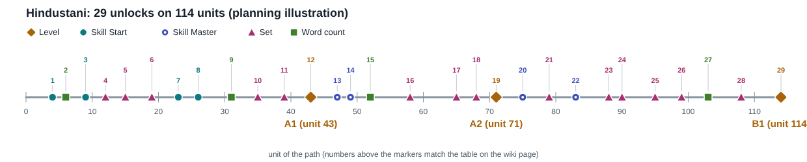
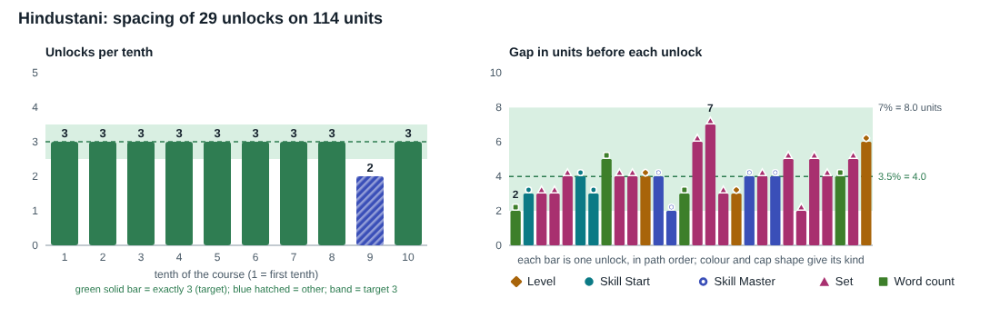
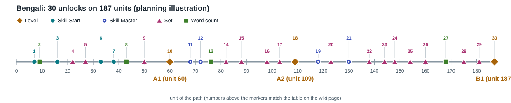
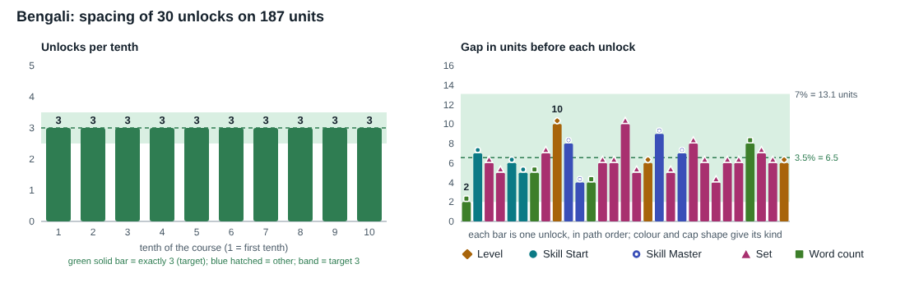

# Plan: achievements pacing, the approved decisions and the plots

Source of truth: this wiki page.

Written 2026-11-27. Extends [Plan-Achievements](Plan-Achievements). The owner approved the looks and the pacing of the achievements mockup on 2026-11-27 and ordered: "save the details and the plots to the wiki". This page is that record. The achievements mockup (PR #1743, branch `mockup/achievements`, revision 3, commit `30a2ba370`) is removed now that the feature is built; its decisions are recorded on this page. The plots are planning illustrations drawn from the same unit numbers; they were first published as the artifact [Achievements pacing](https://claude.ai/artifact/5yz6tyGs9d1ehbPTqJhP1w) (an interactive page, private to the owner).

Status (2026-11-27): built. The engine is merged (PR #1745) and the screens (PR #1747): the Progress badges page, the latest-badge line, and the Summary announcement; earned dates are stored in the settings store so a badge is never lost. Not built: the set lists in each course's path file (`achievement_sets`, content on decks-live: the Sets tab says none are chosen until they exist) and the Play Games flavour (decision 5, later). Parent issue #223.

**The Journey and the spacing plots are not app screens.** The owner, 2026-11-27: "the journey or the spacing plots should not be in the app." They are planning aids for the engine's rule below. Decision 12 of revision 2 (one Journey per language) was withdrawn; decisions 1 to 11 keep their numbers.

## The owner's orders that shaped it

- 2026-11-27, on the first mockup: "approved on the looks, but you need to add more categories, like for each skill (start and master). and then for mastering specific topics or sets (like the pronouns, or kins). the plan is to build achievements spaced to unlock throughout the course at a more or less even manner."
- 2026-11-27, on revision 2: "the journey or the spacing plots should not be in the app. and give me an artefact".
- 2026-11-27: approved the looks and the pacing, and: "save the details and the plots to the wiki".

## The approved decisions (2026-11-27)

The owner took the recommended default of each (answer "yes" to all). Each is given with its main downside.

1. **Level badges (A1, A2, B1): remembered, not taught.** A level comes when every card up to its mark is known, a card counting once it has been known at any time, so a later lapse never takes a badge away (the log is never edited, ADR-0005). Same rule as the Level tile. Downside: slower, and one lapsed card can hold a level back.
2. **Basic badges and thresholds: the plan's list as drawn.** Words 100, 500, 1,000, 2,500; streaks 3, 7, 30, 100, 365 days; answers 1,000 and 10,000. Downside: some tiers are far away; they show locked. Add 5,000 words later only if the B1 plans exceed 2,500.
3. **Streaks: the whole app only**, not per language. Progress still shows per-language streak numbers as today, with no badges for them. Downside: no credit for a per-language run, but that avoids the daily pressure the plan rejects.
4. **Achievements from past reviews on first launch: quiet.** One small card on that first summary, never repeated, with the badges in a row dated when first met. Downside: a long-time learner gets a muted welcome.
5. **Play Games: beside the GitHub build**, as a separate flavour with `games_services`, built after the app is on the Play Store. Downside: two flavours to test and release. Sign-in would be an optional row in Settings, Your data.
6. **The Start and Master bars per skill: tied to path marks** (table below). Read and Write Master at the A1 mark, Hear and Speak Master at the A2 mark. Downside: a skill with few cards on the path, such as Speak, has a small Master.
7. **Which sets count: a chosen list per course**, about 14 sets (five word sets and nine grammar tables), kept in the path file beside the units, so a language gets only the sets it has decks for. Downside: someone chooses them once.
8. **"Mastered" for a set: all cards known**, a card counting once it was ever known, like decision 1. Downside: one hard card holds the badge back.
9. **The pacing target: one unlock per 3.5% of the plan**, never closer than 2 units, never farther than about 7%. Downside: more badges than the earlier 19 (about 30 a course).
10. **The old Firsts are folded.** Passage and spoken fold into Hear Start and Speak Start; Script into Read Start and Master; First deck is dropped (the first set stands for it); First lesson stays under Other. This replaces part of decision 2's list; its words, streaks and answers are unchanged.
11. **Skills marked Leave are shown dimmed**, with "Not part of your plan" under the name, and are not earnable. Downside: still on screen.

## The categories

Progress has four tabs:

- **Levels**: A1, A2 and B1 (drawn with `LevelBadge`, #678) and the four word counts (100, 500, 1,000, 2,500).
- **Skills**: for each skill a **Start** and a **Master**. The app's skills are Speak, Hear, Read and Write (`SkillKind`, `lib/core/languages/language_skills.dart`); Read and Write belong to a script; a sign language has one skill, Gestures, so one Start and one Master.
- **Sets**: **Word sets** (themes of `decks/themes.yaml`) and **Grammar tables** (the grammar decks of the path). A set is one deck group of the path: its deck, sentences deck and reading deck. Hindustani shows 14 sets and Bengali 15.
- **Other**: First lesson, streaks (3, 7, 30, 100, 365 days) and answer counts (1,000 and 10,000). These follow days or answers, not the path.

### Start and Master per skill

"Know" is the Level tile's rule (decision 1). A Master badge is dated when the last card of its bar became known.

| Skill | Start | Master | Hindustani units | Bengali units |
|---|---|---|---|---|
| Hear | Hear and answer 10 audio cards. | Know every listening card up to the A2 mark. | 4 and 75 | 7 and 118 |
| Speak | Say an answer aloud and have it heard. | Know every speaking card up to the A2 mark. | 23 and 83 | 33 and 130 |
| Read (per script) | Know your first 5 letters of the script. | Know every script and reading card up to the A1 mark. | 9 and 47 | 16 and 68 |
| Write (per script) | Write your first 5 letters. | Know every writing card up to the A1 mark. | 26 and 49 | 38 and 72 |

| Gestures (sign languages) | Recognise and make 10 signs. | Know every gesture card up to the A2 mark. | one pair, placed as Hear | one pair, placed as Hear |

### Example sets

A dash means the language has no chosen set for that topic. Card counts are the mockup's examples. Hindustani examples: Pronouns (मैं, तुम, आप, वह, हम), Family (माँ, पिता, भाई, बहन, बुआ), Numbers 1-20 (एक, दो, तीन). Bengali: Pronouns (আমি, তুমি, আপনি, সে, আমরা), Family (মা, বাবা, ভাই, বোন, পিসি), Numbers 1-20 (এক, দুই, তিন).

| Set | Type | Cards | Hindustani unit | Bengali unit |
|---|---|---|---|---|
| Pronouns and people words | Word set | 24 | 12 | 22 |
| Family words | Word set | 16 | 15 | 27 |
| Numbers 1-20 | Word set | 30 | 19 | 50 |
| Food and drink | Word set | 40 | 35 | - |
| Festivals and celebrations | Word set | 36 | 65 | - |
| Nouns and postpositions | Grammar table | 34 | 39 | - |
| The past tense table | Grammar table | 40 | 58 | 82 |
| The future tense table | Grammar table | 36 | 68 | - |
| Relative clauses | Grammar table | 28 | 79 | 123 |
| Conditional clauses | Grammar table | 30 | 88 | 138 |
| Purpose clauses | Grammar table | 24 | 90 | 144 |
| Causative verbs | Grammar table | 32 | 95 | 154 |
| Indefinite words | Grammar table | 26 | 99 | - |
| The passive | Grammar table | 30 | 108 | 175 |
| Compound verbs | Grammar table | 38 | - | 88 |
| Comparison | Grammar table | 24 | - | 98 |
| Imperatives | Grammar table | 28 | - | 103 |
| Before and after | Grammar table | 26 | - | 148 |
| Concessive clauses | Grammar table | 24 | - | 160 |
| Reported speech | Grammar table | 30 | - | 181 |

## The pacing rule (engine design, no screen)

The path is the timeline: unit 1 to the B1 mark. Every achievement is attached to a position on it. The numbers below are the real ones of decks-live's paths (Hindustani 114 units, marks at 43, 71 and 114; Bengali 187 units, marks at 60, 109 and 187). The placement is illustrative; the engine computes the real positions from the path files and the card counts.

1. **Target gap.** One unlock about every **3.5% of the B1 plan**, about 30 per course (Hindustani one per 3.9 units, Bengali one per 6.2). Never closer than **2 units**, never farther apart than about **7%** of the plan.
2. **Fixed anchors first.**
   - The three levels sit on their marks.
   - The word counts sit where the plan's sizes (about 700, 900 and 1,200 words per level) reach them: 100 words at about 5% of the plan, 500 at 27%, 1,000 at 46%, 2,500 at 90%.
   - A Start sits where its first step is first possible (Hear after the first audio units, Read and Write after the script units, Speak when the first speaking card appears); a Master sits just after the mark of its bar.
3. **Sets fill the rest.** Each tenth of the course should hold 3 unlocks. A set's natural position is its last path unit plus a review lag; if that tenth already holds 3, it **slides to the nearest tenth with fewer than 3**. Word sets are taken first, then grammar tables in path order.
4. **Streaks and answer counts are not on the path.** They follow days, so they sit under Other and are never counted in the spread.
5. **A short path** (45 units to B1) keeps all anchors, picks fewer sets, and the 2-unit minimum gap applies, so the gap becomes about 2.6 units. A path with only A1 built places only the A1 part: A2, B1 and what lies past them are not placed (and not shown on Progress) until the plan exists, so nothing promises what is not there.

## The plots

Not app screens. Each image links to its SVG (the PNG is a render of the same drawing). They have a white background and explicit colours, so they read in light and dark themes. Kinds are told apart by colour and by shape: diamond is a Level, circle a Skill Start, ringed circle a Skill Master, triangle a Set, square a Word count. Source files are in `docs/achievements-pacing/`; the images are embedded from `main` because the wiki sync copies Markdown pages only.

### Hindustani

### Bengali

### Computed spacing

| | Hindustani | Bengali |
|---|---|---|
| Unlocks on the path | 29 | 30 |
| Units to the B1 mark | 114 | 187 |
| Unlocks per tenth (1 to 10) | 3, 3, 3, 3, 3, 3, 3, 3, 2, 3 | 3 in every tenth |
| Tenths with exactly 3 | 9 of 10 (the ninth has 2) | 10 of 10 |
| Closest gap | 2 units | 2 units |
| Furthest gap | 7 units (limit 8.0, 7%) | 10 units (limit 13.1, 7%) |
| Gaps under 2 units, or over 7% | none | none |

Nothing bunches at the start or the end.

## Placement tables

Unit is the path unit where the unlock is placed; "% of plan" is unit over the B1 mark. The number matches the markers on the timeline plots.

### Hindustani (114 units, marks 43, 71, 114)

| # | Unit | % of plan | Kind | Unlock |
|---|---|---|---|---|
| 1 | 4 | 3.5% | Skill Start | Hear Start |
| 2 | 6 | 5.3% | Word count | 100 words |
| 3 | 9 | 7.9% | Skill Start | Read Start |
| 4 | 12 | 10.5% | Set | Pronouns and people words |
| 5 | 15 | 13.2% | Set | Family words |
| 6 | 19 | 16.7% | Set | Numbers 1-20 |
| 7 | 23 | 20.2% | Skill Start | Speak Start |
| 8 | 26 | 22.8% | Skill Start | Write Start |
| 9 | 31 | 27.2% | Word count | 500 words |
| 10 | 35 | 30.7% | Set | Food and drink |
| 11 | 39 | 34.2% | Set | Nouns and postpositions |
| 12 | 43 | 37.7% | Level | A1 |
| 13 | 47 | 41.2% | Skill Master | Read Master |
| 14 | 49 | 43.0% | Skill Master | Write Master |
| 15 | 52 | 45.6% | Word count | 1,000 words |
| 16 | 58 | 50.9% | Set | The past tense table |
| 17 | 65 | 57.0% | Set | Festivals and celebrations |
| 18 | 68 | 59.6% | Set | The future tense table |
| 19 | 71 | 62.3% | Level | A2 |
| 20 | 75 | 65.8% | Skill Master | Hear Master |
| 21 | 79 | 69.3% | Set | Relative clauses |
| 22 | 83 | 72.8% | Skill Master | Speak Master |
| 23 | 88 | 77.2% | Set | Conditional clauses |
| 24 | 90 | 78.9% | Set | Purpose clauses |
| 25 | 95 | 83.3% | Set | Causative verbs |
| 26 | 99 | 86.8% | Set | Indefinite words |
| 27 | 103 | 90.4% | Word count | 2,500 words |
| 28 | 108 | 94.7% | Set | The passive |
| 29 | 114 | 100.0% | Level | B1 |

### Bengali (187 units, marks 60, 109, 187)

| # | Unit | % of plan | Kind | Unlock |
|---|---|---|---|---|
| 1 | 7 | 3.7% | Skill Start | Hear Start |
| 2 | 9 | 4.8% | Word count | 100 words |
| 3 | 16 | 8.6% | Skill Start | Read Start |
| 4 | 22 | 11.8% | Set | Pronouns and people words |
| 5 | 27 | 14.4% | Set | Family words |
| 6 | 33 | 17.6% | Skill Start | Speak Start |
| 7 | 38 | 20.3% | Skill Start | Write Start |
| 8 | 43 | 23.0% | Word count | 500 words |
| 9 | 50 | 26.7% | Set | Numbers 1-20 |
| 10 | 60 | 32.1% | Level | A1 |
| 11 | 68 | 36.4% | Skill Master | Read Master |
| 12 | 72 | 38.5% | Skill Master | Write Master |
| 13 | 76 | 40.6% | Word count | 1,000 words |
| 14 | 82 | 43.9% | Set | The past tense table |
| 15 | 88 | 47.1% | Set | Compound verbs |
| 16 | 98 | 52.4% | Set | Comparison |
| 17 | 103 | 55.1% | Set | Imperatives |
| 18 | 109 | 58.3% | Level | A2 |
| 19 | 118 | 63.1% | Skill Master | Hear Master |
| 20 | 123 | 65.8% | Set | Relative clauses |
| 21 | 130 | 69.5% | Skill Master | Speak Master |
| 22 | 138 | 73.8% | Set | Conditional clauses |
| 23 | 144 | 77.0% | Set | Purpose clauses |
| 24 | 148 | 79.1% | Set | Before and after |
| 25 | 154 | 82.4% | Set | Causative verbs |
| 26 | 160 | 85.6% | Set | Concessive clauses |
| 27 | 168 | 89.8% | Word count | 2,500 words |
| 28 | 175 | 93.6% | Set | The passive |
| 29 | 181 | 96.8% | Set | Reported speech |
| 30 | 187 | 100.0% | Level | B1 |

## Notes

- Nothing is stored but which badges have been shown; every badge is a rule over the review log and the catalog that finds its date, so backup and restore keep them.
- Badge names and how-to lines are app text (English until #46); only the language chip and example words are in Devanagari or Bengali script.
- Icons are Material icons already in the app's icon set; no new fonts or images in the app.

See also: [Plan-Achievements](Plan-Achievements) · [Plan-B1-Plans](Plan-B1-Plans) · [Plans-Index](Plans-Index) · [Roadmap](Roadmap) · [Home](Home)
